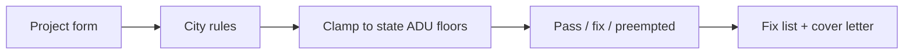

<div align="center">

# PermitPrecheck

**Check an ADU plan set against city rules and California law before the city does.**

Built for the bottleneck at **Abodu** · Tool 8 of 10

    

[**▶ Watch the demo**](abodu-permit-precheck-demo.mp4) · [Quick start](#quick-start) · [How to use it](#how-to-use-it) · [How it works](#how-it-works)

</div>

---

## Table of contents

- [The bottleneck](#the-bottleneck)
- [Features](#features)
- [Quick start](#quick-start)
- [How to use it](#how-to-use-it)
- [Input format](#input-format)
- [How it works](#how-it-works)
- [Demo video](#demo-video)
- [Project structure](#project-structure)
- [Limitations](#limitations)

## The bottleneck

Abodu's backyard homes get fast permits in pre-approved cities. Elsewhere, plan checks take months of correction rounds, and some local denials rely on rules that state ADU law no longer allows.

## Features

- Checks the project against the selected city's rules
- Clamps each city rule to the California ADU state floor, so preempted rules are flagged instead of obeyed
- Lists missing sheets and real fixes before submission
- Drafts a cover letter citing the local rules that state law overrides

## Quick start

No install, no build step and no network. You only need a modern browser (Chrome, Edge, Safari or Firefox).

```bash
open index.html
```

> [!TIP]
> Add `?demo=1` to the URL to watch the scripted walkthrough instead of using the tool yourself:
> `index.html?demo=1`

> [!IMPORTANT]
> The page loads its styles and helpers from `../shared/`. If you copy this folder on its own, copy `shared/` next to it
> (keep the same layout), or the page will load without styling.

## How to use it

1. Fill in **1 · Project**: jurisdiction, Abodu model, height, setbacks, distance to transit, lot slope, sprinklers and the sheets in the permit set.
2. Click **Run plan check**.
3. Review **2 · Rule-by-rule result**. In the sample, the city's 750 sq ft size cap is flagged as preempted.
4. Work through **3 · Fix before submitting** (the sample is missing a tree survey and a soils report).
5. Attach **4 · Cover letter** to the submission.

## Input format

Only the form fields on the page. City rule sets are built in and fictional.

## How it works



Each local rule is compared with the state minimum. A stricter local rule than the law allows is marked preempted and cited in the letter; everything else is a real pass or a fix.

## Demo video

[`abodu-permit-precheck-demo.mp4`](abodu-permit-precheck-demo.mp4) is a 1280×720 recording of the `?demo=1` walkthrough (about 50 seconds).

To record it again, from the parent folder:

```bash
python3 record.py abodu-permit-precheck
```

## Project structure

```text
abodu-permit-precheck/
├── index.html              # page layout
├── app.js                  # tool logic and the demo script
├── abodu-permit-precheck-demo.mp4 # recorded walkthrough
└── README.md
../shared/
├── style.css               # shared look and demo overlays
└── demo.js                 # demo driver and helpers (charts, RNG, download)
```

## Limitations

> [!NOTE]
> All data in this tool is synthetic. Abodu is named only to identify whose publicly reported bottleneck this targets;
> the company is not affiliated with this project and has not reviewed it.

- The tool uses deterministic rules so it runs offline and gives the same result every time.
- **What a production version would add:** An LLM reading the city's municipal code and correction letters, kept current with state ADU law.
- Regulatory and engineering content is simplified for illustration and is not professional advice.

<div align="right"><a href="#permitprecheck">↑ Back to top</a></div>
