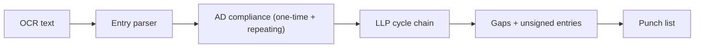

<div align="center">

# RecordsCheck

**Audit an aircraft's maintenance records for lease return: AD status, part histories and a punch list.**

Built for the bottleneck at **Airborne Capital** · Tool 6 of 10

    

[**▶ Watch the demo**](airborne-recordscheck-demo.mp4) · [Quick start](#quick-start) · [How to use it](#how-to-use-it) · [How it works](#how-it-works)

</div>

---

## Table of contents

- [The bottleneck](#the-bottleneck)
- [Features](#features)
- [Quick start](#quick-start)
- [How to use it](#how-to-use-it)
- [Input format](#input-format)
- [How it works](#how-it-works)
- [Demo video](#demo-video)
- [Project structure](#project-structure)
- [Limitations](#limitations)

## The bottleneck

When a leased aircraft is returned, its paper and PDF records must prove every airworthiness directive (AD) is complied with and every life-limited part (LLP) has an unbroken history. Reviewing them by hand is slow.

## Features

- Parses OCR'd logbook and work-package text
- Computes AD status, including repeating ADs by flight hours (FH) or flight cycles (FC)
- Traces each life-limited part back to birth and finds gaps in its cycle history
- Finds unsigned entries
- Builds a redelivery punch list

## Quick start

No install, no build step and no network. You only need a modern browser (Chrome, Edge, Safari or Firefox).

```bash
open index.html
```

> [!TIP]
> Add `?demo=1` to the URL to watch the scripted walkthrough instead of using the tool yourself:
> `index.html?demo=1`

> [!IMPORTANT]
> The page loads its styles and helpers from `../shared/`. If you copy this folder on its own, copy `shared/` next to it
> (keep the same layout), or the page will load without styling.

## How to use it

1. Fill in **1 · Aircraft**: type/MSN, current flight hours and cycles, records as-of date, and the applicable ADs.
2. Paste the OCR text into **2 · OCR'd logbook and work-package text**. Sample records are preloaded.
3. Click **Audit records**.
4. Check **3 · AD compliance** and **4 · Life-limited parts**. In the sample, the LPT shaft has a back-to-birth gap.
5. Send **5 · Redelivery punch list** to the records team.

## Input format

One entry per line. The parser picks out these tokens anywhere in the line:

| Token | Example |
|-------|---------|
| Date | `2021-03-14` |
| Flight hours / cycles | `FH 18250`, `FC 9800` |
| AD reference | in the sample's fictional `AD 20XX-0X-XX` format |
| Part serial and cycles since new | `S/N LS0915`, `CSN 10200` |

## How it works



For each AD, the latest compliance entry is compared with the repeat interval to find the next due point. For each LLP, cycles since new must grow consistently with aircraft cycles between entries; a jump that can't be explained is a gap.

## Demo video

[`airborne-recordscheck-demo.mp4`](airborne-recordscheck-demo.mp4) is a 1280×720 recording of the `?demo=1` walkthrough (about 50 seconds).

To record it again, from the parent folder:

```bash
python3 record.py airborne-recordscheck
```

## Project structure

```text
airborne-recordscheck/
├── index.html              # page layout
├── app.js                  # tool logic and the demo script
├── airborne-recordscheck-demo.mp4 # recorded walkthrough
└── README.md
../shared/
├── style.css               # shared look and demo overlays
└── demo.js                 # demo driver and helpers (charts, RNG, download)
```

## Limitations

> [!NOTE]
> All data in this tool is synthetic. Airborne Capital is named only to identify whose publicly reported bottleneck this targets;
> the company is not affiliated with this project and has not reviewed it.

- The tool uses deterministic rules so it runs offline and gives the same result every time.
- **What a production version would add:** A vision/OCR model reading the scanned logbooks directly, and the regulator's live AD database.
- Regulatory and engineering content is simplified for illustration and is not professional advice.

<div align="right"><a href="#recordscheck">↑ Back to top</a></div>
