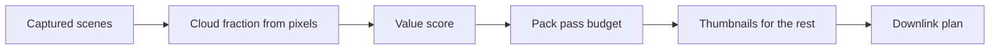

<div align="center">

# DownlinkIQ

**Score every capture on board, then spend each ground pass on the images customers can use.**

Built for the bottleneck at **Albedo** · Tool 10 of 10

    

[**▶ Watch the demo**](albedo-downlink-triage-demo.mp4) · [Quick start](#quick-start) · [How to use it](#how-to-use-it) · [How it works](#how-it-works)

</div>

---

## Table of contents

- [The bottleneck](#the-bottleneck)
- [Features](#features)
- [Quick start](#quick-start)
- [How to use it](#how-to-use-it)
- [Input format](#input-format)
- [How it works](#how-it-works)
- [Demo video](#demo-video)
- [Project structure](#project-structure)
- [Limitations](#limitations)

## The bottleneck

Albedo's Clarity-1 sends 10 cm imagery down an 800 Mbps link, but a ground station sees the satellite for only about ten minutes. Sending scenes in capture order wastes passes on clouds and leaves customer images behind.

## Features

- Estimates cloud cover from the pixels
- Scores each scene by tasking, detected change and clarity
- Packs the pass budget with the highest-value clear scenes
- Reserves room for a thumbnail of everything else so the catalog stays complete
- Compares the plan with first-in first-out on the same pass

## Quick start

No install, no build step and no network. You only need a modern browser (Chrome, Edge, Safari or Firefox).

```bash
open index.html
```

Or download this tool on its own, with the shared files included: [**albedo-downlink-triage-code.zip**](https://github.com/sseanyk/company-ai-solutions/releases/download/v1.0/albedo-downlink-triage-code.zip). Unzip it and open `albedo-downlink-triage/index.html`.

> [!TIP]
> Add `?demo=1` to the URL to watch the scripted walkthrough instead of using the tool yourself:
> `index.html?demo=1`

> [!IMPORTANT]
> The page loads its styles and helpers from `../shared/`. If you copy this folder on its own, copy `shared/` next to it
> (keep the same layout), or the page will load without styling.

## How to use it

1. Set **Pass length**, **Link rate** and **Scene size** (defaults: 10 min, 800 Mbps, 2.5 GB).
2. Click **Plan pass: first-in first-out** to see today's approach.
3. Click **Plan pass: onboard triage**.
4. Compare the two rows in **2 · What the pass delivered**. On the defaults, triage delivers 19/19 clear tasked scenes versus 5/19, and spends 0 GB on cloud.
5. Check **3 · Top of the downlink queue** for the scores behind the order.

## Input format

Only the three pass settings. The 70 scenes are generated.

## How it works



Cloud fraction is the share of bright, low-saturation pixels; scenes over 40% are skipped. The score weights customer tasking and detected change, and a greedy pass fills the budget after holding back 0.02 GB per scene for thumbnails.

## Demo video

[`albedo-downlink-triage-demo.mp4`](albedo-downlink-triage-demo.mp4) is a 1280×720 recording of the `?demo=1` walkthrough (about 50 seconds).

To record it again, from the parent folder:

```bash
python3 record.py albedo-downlink-triage
```

## Project structure

```text
albedo-downlink-triage/
├── index.html              # page layout
├── app.js                  # tool logic and the demo script
├── albedo-downlink-triage-demo.mp4 # recorded walkthrough
└── README.md
../shared/
├── style.css               # shared look and demo overlays
└── demo.js                 # demo driver and helpers (charts, RNG, download)
```

## Limitations

> [!NOTE]
> All data in this tool is synthetic. Albedo is named only to identify whose publicly reported bottleneck this targets;
> the company is not affiliated with this project and has not reviewed it.

- The tool uses deterministic rules so it runs offline and gives the same result every time.
- **What a production version would add:** A quantized model on the satellite's edge processor, and the operator's real tasking queue.
- Regulatory and engineering content is simplified for illustration and is not professional advice.

<div align="right"><a href="#downlinkiq">↑ Back to top</a></div>
