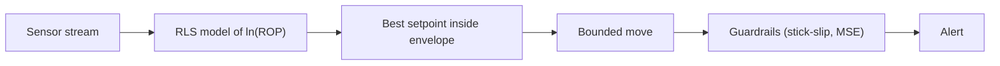

<div align="center">

# ROP Copilot

**Learn the rock's response while drilling and move the setpoints toward the fastest safe rate.**

Built for the bottleneck at **Fervo Energy** · Tool 9 of 10

    

[**▶ Watch the demo**](fervo-rop-copilot-demo.mp4) · [Quick start](#quick-start) · [How to use it](#how-to-use-it) · [How it works](#how-it-works)

</div>

---

## Table of contents

- [The bottleneck](#the-bottleneck)
- [Features](#features)
- [Quick start](#quick-start)
- [How to use it](#how-to-use-it)
- [Input format](#input-format)
- [How it works](#how-it-works)
- [Demo video](#demo-video)
- [Project structure](#project-structure)
- [Limitations](#limitations)

## The bottleneck

Drilling is over 75% of a geothermal well's cost, and in hard rock the lever is on-bottom rate of penetration (ROP) and bit life. Fixed setpoints leave speed on the table and miss bit damage until it has cost hours.

## Features

- Learns online from the rig's sensor feed only (weight on bit, RPM, torque, ROP)
- Moves WOB and RPM in small bounded steps inside the safety envelope
- Backs off after stick-slip is seen
- Flags suspected bit damage from rising mechanical specific energy (MSE)
- Explains every recommendation in plain text

## Quick start

No install, no build step and no network. You only need a modern browser (Chrome, Edge, Safari or Firefox).

```bash
open index.html
```

> [!TIP]
> Add `?demo=1` to the URL to watch the scripted walkthrough instead of using the tool yourself:
> `index.html?demo=1`

> [!IMPORTANT]
> The page loads its styles and helpers from `../shared/`. If you copy this folder on its own, copy `shared/` next to it
> (keep the same layout), or the page will load without styling.

## How to use it

1. Click **▶ Start drilling (driller setpoints)**. The simulated rig drills at a fixed 30 klbf and 100 rpm.
2. Click **Engage copilot**.
3. Watch **ROP vs depth** and **Current recommendation** as it adjusts the setpoints.
4. Watch **Mechanical specific energy** and **Stick-slip index**. An alert appears when a cutter chips.
5. When the section completes, the KPI tiles show the ROP gain on the same rock (about +55% in the simulation).

## Input format

None. The rig and rock are simulated in the page.

## How it works



Recursive least squares fits `ln(ROP) = a + b·W + c·W² + d·ln(RPM)` as it drills, with small dithering to keep learning. Each decision searches the safe envelope for the highest predicted ROP and moves partway there. A rising MSE at unchanged setpoints signals bit damage.

## Demo video

[`fervo-rop-copilot-demo.mp4`](fervo-rop-copilot-demo.mp4) is a 1280×720 recording of the `?demo=1` walkthrough (about 50 seconds).

To record it again, from the parent folder:

```bash
python3 record.py fervo-rop-copilot
```

## Project structure

```text
fervo-rop-copilot/
├── index.html              # page layout
├── app.js                  # tool logic and the demo script
├── fervo-rop-copilot-demo.mp4 # recorded walkthrough
└── README.md
../shared/
├── style.css               # shared look and demo overlays
└── demo.js                 # demo driver and helpers (charts, RNG, download)
```

## Limitations

> [!NOTE]
> All data in this tool is synthetic. Fervo Energy is named only to identify whose publicly reported bottleneck this targets;
> the company is not affiliated with this project and has not reviewed it.

- The tool uses deterministic rules so it runs offline and gives the same result every time.
- **What a production version would add:** Connection to the rig's WITSML feed, the driller's approval loop, and limits from the bit and motor vendors.
- Regulatory and engineering content is simplified for illustration and is not professional advice.

<div align="right"><a href="#rop-copilot">↑ Back to top</a></div>
