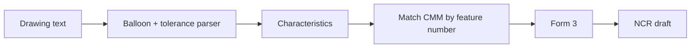

<div align="center">

# AutoBalloon

**Turn a part drawing and a CMM report into an AS9102 first-article inspection package in minutes.**

Built for the bottleneck at **Hadrian** · Tool 3 of 10

    

[**▶ Watch the demo**](hadrian-autoballoon-demo.mp4) · [Quick start](#quick-start) · [How to use it](#how-to-use-it) · [How it works](#how-it-works)

</div>

---

## Table of contents

- [The bottleneck](#the-bottleneck)
- [Features](#features)
- [Quick start](#quick-start)
- [How to use it](#how-to-use-it)
- [Input format](#input-format)
- [How it works](#how-it-works)
- [Demo video](#demo-video)
- [Project structure](#project-structure)
- [Limitations](#limitations)

## The bottleneck

Aerospace first-article inspection means numbering ("ballooning") every dimension on the customer drawing, typing each tolerance into Form 3, and matching it to the measurement report. It often takes 40+ hours per part.

## Features

- Balloons every dimension on the drawing automatically
- Parses `±`, `+a/-b`, `4X` quantities, `THRU` holes, true position (with datums), flatness and surface finish
- Matches raw CMM output to each characteristic by feature number
- Builds AS9102 Form 3 (Characteristic Accountability) with pass/fail per line
- Drafts a nonconformance report for anything out of tolerance
- Exports Form 3 as CSV

## Quick start

No install, no build step and no network. You only need a modern browser (Chrome, Edge, Safari or Firefox).

```bash
open index.html
```

> [!TIP]
> Add `?demo=1` to the URL to watch the scripted walkthrough instead of using the tool yourself:
> `index.html?demo=1`

> [!IMPORTANT]
> The page loads its styles and helpers from `../shared/`. If you copy this folder on its own, copy `shared/` next to it
> (keep the same layout), or the page will load without styling.

## How to use it

1. Click **Auto-balloon drawing**. Numbered balloons appear on **1 · Customer drawing** and the characteristics table fills in.
2. Paste the CMM output into **2 · CMM report**. A sample report is preloaded.
3. Click **Match results → Form 3**.
4. Review **3 · AS9102 Form 3** and click **Export Form 3 CSV**.
5. Copy the draft in **4 · Nonconformance draft** if any line failed. The sample has 12 conforming lines and 1 failure (char 9).

## Input format

CMM lines in the form `FEAT_<number> <type> <measured value>`, one per line, for example:

```text
FEAT_01        L      50.0120
FEAT_09        D      40.0710
```

Other lines (headers, blank lines) are ignored.

## How it works



Each dimension string is parsed into nominal, lower and upper limits (GD&T callouts become one-sided limits). CMM values are matched by feature number and checked against those limits.

## Demo video

[`hadrian-autoballoon-demo.mp4`](hadrian-autoballoon-demo.mp4) is a 1280×720 recording of the `?demo=1` walkthrough (about 50 seconds).

To record it again, from the parent folder:

```bash
python3 record.py hadrian-autoballoon
```

## Project structure

```text
hadrian-autoballoon/
├── index.html              # page layout
├── app.js                  # tool logic and the demo script
├── hadrian-autoballoon-demo.mp4 # recorded walkthrough
└── README.md
../shared/
├── style.css               # shared look and demo overlays
└── demo.js                 # demo driver and helpers (charts, RNG, download)
```

## Limitations

> [!NOTE]
> All data in this tool is synthetic. Hadrian is named only to identify whose publicly reported bottleneck this targets;
> the company is not affiliated with this project and has not reviewed it.

- The tool uses deterministic rules so it runs offline and gives the same result every time.
- **What a production version would add:** A vision model reading the customer's PDF drawing, and direct import from the CMM software's native export.
- Regulatory and engineering content is simplified for illustration and is not professional advice.

<div align="right"><a href="#autoballoon">↑ Back to top</a></div>
