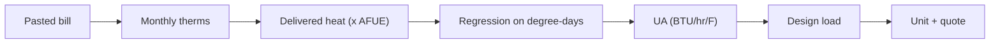

<div align="center">

# LoadLens

**Size a heat pump from the customer's real gas bills instead of a padded rule of thumb.**

Built for the bottleneck at **Jetson** · Tool 2 of 10

    

[**▶ Watch the demo**](jetson-loadlens-demo.mp4) · [Quick start](#quick-start) · [How to use it](#how-to-use-it) · [How it works](#how-it-works)

</div>

---

## Table of contents

- [The bottleneck](#the-bottleneck)
- [Features](#features)
- [Quick start](#quick-start)
- [How to use it](#how-to-use-it)
- [Input format](#input-format)
- [How it works](#how-it-works)
- [Demo video](#demo-video)
- [Project structure](#project-structure)
- [Limitations](#limitations)

## The bottleneck

Every heat pump quote needs a heating load calculation. Conventional Manual J inputs are slow to gather and Jetson reports they run 30–40% high, so homes get oversized, pricier equipment.

## Features

- Reads a pasted utility bill in almost any format (one month per line)
- Accepts therms or CCF, ignores years and dollar amounts
- Fits gas use against heating degree-days to measure the home's actual heat loss
- Compares three sizing methods side by side
- Picks a cold-climate unit that covers the load at the design temperature
- Drafts the customer quote and a sizing report

## Quick start

No install, no build step and no network. You only need a modern browser (Chrome, Edge, Safari or Firefox).

```bash
open index.html
```

Or download this tool on its own, with the shared files included: [**jetson-loadlens-code.zip**](https://github.com/sseanyk/company-ai-solutions/releases/download/v1.0/jetson-loadlens-code.zip). Unzip it and open `jetson-loadlens/index.html`.

> [!TIP]
> Add `?demo=1` to the URL to watch the scripted walkthrough instead of using the tool yourself:
> `index.html?demo=1`

> [!IMPORTANT]
> The page loads its styles and helpers from `../shared/`. If you copy this folder on its own, copy `shared/` next to it
> (keep the same layout), or the page will load without styling.

## How to use it

1. Fill in **1 · Home**: location, floor area, existing furnace efficiency (AFUE) and customer name.
2. Paste the customer's bill history into **2 · Paste the utility bill history**. A sample is preloaded.
3. Click **Calculate load & quote**.
4. Check **3 · Monthly gas vs heating degree-days**: the points should fall close to the fitted line.
5. Compare the methods in **4 · Three sizing methods compared**, then copy the draft from **5 · Draft quote**.

## Input format

Free text, one line per month. Each line needs a month name and a usage number, for example:

```text
Jan 2025   182 therms   31 days   $349.44
February: 154 thm
Mar 2025, 1,320 ccf
```

Locations available: Boston, Albany, Denver and Minneapolis (each with its design temperature and degree-days).

## How it works



Monthly therms times furnace efficiency gives the heat the house actually used. Regressing that on heating degree-days gives the heat-loss coefficient UA. The design load is `UA × (70 °F − design temperature)`, and the smallest unit whose cold-weather capacity covers it is chosen.

## Demo video

[`jetson-loadlens-demo.mp4`](jetson-loadlens-demo.mp4) is a 1280×720 recording of the `?demo=1` walkthrough (about 50 seconds).

To record it again, from the parent folder:

```bash
python3 record.py jetson-loadlens
```

## Project structure

```text
jetson-loadlens/
├── index.html              # page layout
├── app.js                  # tool logic and the demo script
├── jetson-loadlens-demo.mp4 # recorded walkthrough
└── README.md
../shared/
├── style.css               # shared look and demo overlays
└── demo.js                 # demo driver and helpers (charts, RNG, download)
```

## Limitations

> [!NOTE]
> All data in this tool is synthetic. Jetson is named only to identify whose publicly reported bottleneck this targets;
> the company is not affiliated with this project and has not reviewed it.

- The tool uses deterministic rules so it runs offline and gives the same result every time.
- **What a production version would add:** Bills pulled from the utility's API (Green Button), local weather-station degree-days, and a full Manual J as a cross-check.
- Regulatory and engineering content is simplified for illustration and is not professional advice.

<div align="right"><a href="#loadlens">↑ Back to top</a></div>
