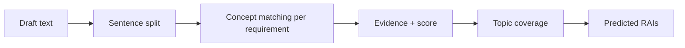

<div align="center">

# LicenseGap

**Find the information gaps an NRC reviewer would find, before the application is filed.**

Built for the bottleneck at **Oklo** · Tool 4 of 10

    

[**▶ Watch the demo**](oklo-licensegap-demo.mp4) · [Quick start](#quick-start) · [How to use it](#how-to-use-it) · [How it works](#how-it-works)

</div>

---

## Table of contents

- [The bottleneck](#the-bottleneck)
- [Features](#features)
- [Quick start](#quick-start)
- [How to use it](#how-to-use-it)
- [Input format](#input-format)
- [How it works](#how-it-works)
- [Demo video](#demo-video)
- [Project structure](#project-structure)
- [Limitations](#limitations)

## The bottleneck

In 2022 the NRC denied Oklo's Aurora combined license application, citing missing information on accident analysis and safety classification of structures, systems and components (SSCs).

## Features

- Checks a draft against a checklist of reviewer expectations, grouped by topic
- Quotes the sentence in the draft that supports each finding, so every score is traceable
- Scores coverage per topic (accident analysis, SSC classification, regulatory applicability, design, site)
- Flags unsupported claims
- Predicts the Requests for Additional Information (RAIs) the NRC is likely to send, and what content closes them

## Quick start

No install, no build step and no network. You only need a modern browser (Chrome, Edge, Safari or Firefox).

```bash
open index.html
```

> [!TIP]
> Add `?demo=1` to the URL to watch the scripted walkthrough instead of using the tool yourself:
> `index.html?demo=1`

> [!IMPORTANT]
> The page loads its styles and helpers from `../shared/`. If you copy this folder on its own, copy `shared/` next to it
> (keep the same layout), or the page will load without styling.

## How to use it

1. Paste draft sections into **1 · Draft application**. A synthetic draft is preloaded.
2. Click **Review against NRC expectations**.
3. Read **2 · Coverage by topic** for the weak areas.
4. Open **3 · Requirement-by-requirement findings** to see the evidence sentence behind each result.
5. Use **4 · Predicted RAIs** as the to-do list before filing.

## Input format

Plain text, pasted section by section. Headings are optional; the checker works sentence by sentence.

## How it works



Each requirement has a set of concept patterns. A requirement is met when a sentence contains the required concepts, and that sentence is shown as evidence. Missing or partial requirements become predicted RAIs.

## Demo video

[`oklo-licensegap-demo.mp4`](oklo-licensegap-demo.mp4) is a 1280×720 recording of the `?demo=1` walkthrough (about 50 seconds).

To record it again, from the parent folder:

```bash
python3 record.py oklo-licensegap
```

## Project structure

```text
oklo-licensegap/
├── index.html              # page layout
├── app.js                  # tool logic and the demo script
├── oklo-licensegap-demo.mp4 # recorded walkthrough
└── README.md
../shared/
├── style.css               # shared look and demo overlays
└── demo.js                 # demo driver and helpers (charts, RNG, download)
```

## Limitations

> [!NOTE]
> All data in this tool is synthetic. Oklo is named only to identify whose publicly reported bottleneck this targets;
> the company is not affiliated with this project and has not reviewed it.

- The tool uses deterministic rules so it runs offline and gives the same result every time.
- **What a production version would add:** An LLM with retrieval over NRC guidance, past RAIs and safety evaluation reports, in place of the fixed patterns.
- Regulatory and engineering content is simplified for illustration and is not professional advice.

<div align="right"><a href="#licensegap">↑ Back to top</a></div>
