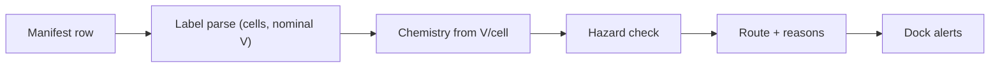

<div align="center">

# IntakeIQ

**Identify, risk-check and route every battery that arrives at the receiving dock.**

Built for the bottleneck at **Redwood Materials** · Tool 7 of 10

    

[**▶ Watch the demo**](redwood-intake-triage-demo.mp4) · [Quick start](#quick-start) · [How to use it](#how-to-use-it) · [How it works](#how-it-works)

</div>

---

## Table of contents

- [The bottleneck](#the-bottleneck)
- [Features](#features)
- [Quick start](#quick-start)
- [How to use it](#how-to-use-it)
- [Input format](#input-format)
- [How it works](#how-it-works)
- [Demo video](#demo-video)
- [Project structure](#project-structure)
- [Limitations](#limitations)

## The bottleneck

Incoming batteries vary wildly: phones, tools, e-bikes and EV modules, many with worn or missing labels. Each must be identified, checked for hazards and routed before it can be processed.

## Features

- Infers chemistry from the label and the measured voltage per cell
- Classifies hazard from temperature, visual condition and state of charge
- Routes each item: direct to recycling, discharge first, second-life test or quarantine
- Explains the reasons behind every decision
- Raises dock alerts for damaged or hot items

## Quick start

No install, no build step and no network. You only need a modern browser (Chrome, Edge, Safari or Firefox).

```bash
open index.html
```

> [!TIP]
> Add `?demo=1` to the URL to watch the scripted walkthrough instead of using the tool yourself:
> `index.html?demo=1`

> [!IMPORTANT]
> The page loads its styles and helpers from `../shared/`. If you copy this folder on its own, copy `shared/` next to it
> (keep the same layout), or the page will load without styling.

## How to use it

1. Check the manifest in **1 · Inbound truck manifest**. Fourteen sample items are preloaded.
2. Click **Triage shipment**.
3. Read **2 · Per-item decisions** for the route and reasons for each item.
4. Check **3 · Routing mix** and act on any dock alerts.

## Input format

Pipe-separated rows after a header row:

```text
ID   | label text (OCR)                         | V_meas | T_C | visual | kg
R-01 | LG INR18650 MJ1 3.6V 3500mAh (box of 400) | 3.41   | 22  | ok     | 19.6
```

## How it works



Voltage per cell separates chemistries (for example LFP sits lower than NMC). Hazard rules combine temperature, visual damage and charge level, and the route follows from chemistry, format and hazard.

## Demo video

[`redwood-intake-triage-demo.mp4`](redwood-intake-triage-demo.mp4) is a 1280×720 recording of the `?demo=1` walkthrough (about 50 seconds).

To record it again, from the parent folder:

```bash
python3 record.py redwood-intake-triage
```

## Project structure

```text
redwood-intake-triage/
├── index.html              # page layout
├── app.js                  # tool logic and the demo script
├── redwood-intake-triage-demo.mp4 # recorded walkthrough
└── README.md
../shared/
├── style.css               # shared look and demo overlays
└── demo.js                 # demo driver and helpers (charts, RNG, download)
```

## Limitations

> [!NOTE]
> All data in this tool is synthetic. Redwood Materials is named only to identify whose publicly reported bottleneck this targets;
> the company is not affiliated with this project and has not reviewed it.

- The tool uses deterministic rules so it runs offline and gives the same result every time.
- **What a production version would add:** A vision model on the dock camera to read labels, and an ML classifier trained on past receiving decisions.
- Regulatory and engineering content is simplified for illustration and is not professional advice.

<div align="right"><a href="#intakeiq">↑ Back to top</a></div>
